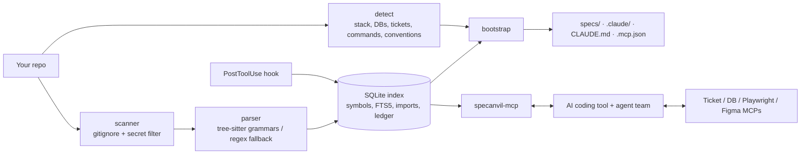

# SpecAnvil

[](https://github.com/Abdulwahab26/SpecAnvil/actions/workflows/ci.yml)  

SpecAnvil sets up spec-driven development in an existing repository with one command. It builds a local code index, detects the stack and conventions, and writes the configuration an AI coding tool needs to work from specifications: a code-index MCP server that returns symbols instead of whole files, project-specific skills, role agents, lifecycle workflows from ticket grooming to end-to-end tests, and connectors for the ticket system and databases in use.

It supports Claude Code, GitHub Copilot, Cursor, Augment Code, Windsurf, OpenAI Codex, Kiro, Gemini CLI and Replit. Indexing, detection and analysis run locally and make no network calls.

```bash
cd your-repo
specanvil init        # about 1 second on a 250-file repo; no AI calls
claude                # then: /sa:learn, /sa:flow PROJ-123
```

Documentation: [architecture and decision records](docs/ARCHITECTURE.md) · [benchmarks and evals](docs/BENCHMARKS.md) · [tool reference](docs/TOOLS.md) · [AI coding tool support](docs/PROVIDERS.md) · [roadmap](ROADMAP.md) · [changelog](CHANGELOG.md)

*Formerly SpecForge. Repositories set up under the old name are upgraded by the next `specanvil init`, and the `specforge` and `specforge-mcp` commands remain as aliases. Workflows are `/sa:<name>`; before 0.10 they were `/sf:<name>`.*

## Measured results

Every figure below is reproducible from this repository. Methods, commits and caveats are in [docs/BENCHMARKS.md](docs/BENCHMARKS.md); the rows marked *CI gate* fail the build if they regress.

| Measurement | Result |
|---|---|
| Tokens returned for 13 typical lookups, against reading the files involved ([full-stack-fastapi-template](https://github.com/fastapi/full-stack-fastapi-template)) | 84% fewer (about 22k against 142k) |
| Retrieval: is the symbol an engineer needs in a 4k-token context? 150 questions, 9 repositories, 9 languages (Python, JavaScript, Go, Java, C#, Rust, PHP, Ruby, Kotlin) | found 97%, MRR 0.76 (*CI gate*: 90%, 0.60) |
| Retrieval on the original 12-task set (Python and TypeScript) | recall 1.00, MRR 0.86 (*CI gate*: 0.95, 0.75) |
| Static call graph against execution: 779 caller/callee pairs observed while running the unit tests | 92% present in the graph (*CI gate*: 85%) |
| Calls through injected dependencies (Spring, NestJS, ASP.NET Core): 66 hand-checked call sites in 5 repositories | 66 resolved to the right method, 0 to a wrong one (*CI gate*: 95%); 14 of 15 on the held-out repository at first run |
| Cold index including call and import graphs (express / fastapi / gin) | 0.3 s / 3.4 s / 0.4 s |
| Scale: Kubernetes (25,126 files, 397,268 symbols) on 2 cores | cold index 67 s, peak memory 393 MB, refresh with no changes 0.3 s, search about 70 ms |
| Refresh after one edit, Django (5.6k files) | 0.14 s |
| Tool schema sent on every turn | about 790 tokens by default (6 tools); about 8,100 with all 96 tools loaded |
| Paraphrased tasks that share no words with the code, `get_context` | 8 of 12 with local embeddings, 3 of 12 without |
| Network calls during indexing | none (a test blocks sockets) |

## Install

Requires Python 3.10 or later. Node 18+ (`npx`) and `uv` (`uvx`) are needed only by the connectors that use them.

```bash
pipx install git+https://github.com/Abdulwahab26/SpecAnvil      # or: uv tool install git+https://github.com/Abdulwahab26/SpecAnvil
specanvil doctor
```

`specanvil-mcp` must be on the `PATH` so the AI coding tool can start it from its MCP configuration.

## Supported AI coding tools

`specanvil init` detects the tools a repository already uses from their configuration folders and writes the same setup in each tool's own format: always-on rules, the lifecycle workflows, role agents, skills and the MCP connection. Select tools explicitly with `--agents cursor,copilot` or `--agents all`.

| Tool | Run a workflow | Files SpecAnvil writes |
|---|---|---|
| Claude Code | `/sa:groom` | `CLAUDE.md`, `.claude/commands`, `.claude/agents`, `.claude/skills`, `.mcp.json` |
| GitHub Copilot | `/sa-groom` | `AGENTS.md`, `.github/prompts`, `.github/agents`, `.github/skills`, `.vscode/mcp.json` |
| Cursor | `/sa-groom` | `AGENTS.md`, `.cursor/commands`, `.cursor/rules/*.mdc`, `.cursor/mcp.json` |
| Augment Code | `/sa:groom` | `AGENTS.md`, `.augment/commands`, `.augment/skills`, MCP import file |
| Windsurf / Devin Local | `sa-groom` skill | `AGENTS.md`, `.agents/skills`, `.devin/mcp_config.json` |
| OpenAI Codex | `sa-groom` skill | `AGENTS.md`, `.agents/skills`, `.codex/agents`, `.codex/config.toml` |
| Kiro | `#sa-groom` | `AGENTS.md`, `.kiro/steering`, feature specs in `.kiro/specs/`, `.kiro/settings/mcp.json` |
| Gemini CLI | `/sa:groom` | `GEMINI.md`, `.gemini/commands/*.toml`, `.gemini/settings.json` |
| Replit Agent | groom playbook | `replit.md`, `.specanvil/playbooks`; tools via `specanvil tool <name> '<json>'` (no local MCP) |

Per-tool limits and the documentation each format was checked against are in [docs/PROVIDERS.md](docs/PROVIDERS.md).

## What `specanvil init` creates

```
your-repo/
├── CLAUDE.md                    # SpecAnvil block added (your content is kept)
├── .mcp.json                    # specanvil + matching connectors (no secrets; ${ENV} refs)
├── .claude/
│   ├── commands/sa/             # 21 commands (below); 22 in an OpenSpec repo (adds baseline)
│   ├── agents/                  # spec-analyst, architect, frontend/backend engineer, db-optimizer,
│   │                            # qa-engineer, e2e-tester, reviewer, unit-test-planner,
│   │                            # unit-test-executor, ticket-archaeologist, doc-writer, summarizer
│   ├── skills/                  # code-navigation, spec-writing, test-case-design,
│   │                            # playwright-e2e, db-optimization (only your engines),
│   │                            # <repo>-conventions, frontend-patterns, backend-patterns
│   └── settings.json            # hooks: secret guard (PreToolUse), re-index (PostToolUse), dedupe reset (PreCompact)
├── specs/
│   ├── project.md               # stack, commands, sub-projects, modules
│   ├── conventions.md           # naming, layout, tests, lint + reference implementations
│   ├── modules/<module>.md      # reverse-engineered public API with code refs
│   └── features/_template/      # requirements, design, tasks, test-cases
└── .specanvil/                  # local index (SQLite), config, spec lock, report.html
```

The stack is detected rather than configured: languages (tree-sitter grammars, with a regex extractor for any language whose grammar is not cached), frameworks, ORMs, databases (from dependencies, docker-compose, Prisma, connection strings, `.env.example`, Spring and ASP.NET configuration), test tools, CI, the ticket system (from git remotes, CI files and `PROJ-123` / `AB#123` keys in commit history) and per-project commands in monorepos. Any detected value can be overridden in `.specanvil/config.json` or with flags.

`specanvil uninstall [tools] [--dry-run] [--purge]` removes exactly what `init` wrote and leaves your own rules, servers, hooks and specs in place.

## Workflows

| Command | Agent | What it does |
|---|---|---|
| `/sa:groom <ticket>` | spec-analyst | Pulls the ticket (Jira / Azure DevOps / GitHub / Linear / GitLab MCP), INVEST check, Gherkin ACs, estimate, split, risks, open questions with defaults |
| `/sa:design <id>` | architect | Options + decision (mini ADR), Mermaid diagram, API contract, data model + migration, component tree, `data-testid` plan, security, test strategy. Uses Figma MCP if linked |
| `/sa:plan <id>` | architect | ≤ half-day tasks, each with a pass/fail check, mapped to ACs, parallel tasks marked |
| `/sa:be <id>` / `/sa:fe <id>` | backend / frontend engineer | Implements by mirroring the closest existing code in the repo, tests included |
| `/sa:db <id\|query\|audit>` | db-optimizer | N+1 hunt, real read-only plans via the DB MCP (Postgres, MySQL, SQL Server, MongoDB, SQLite), index migrations with rollback |
| `/sa:qa <id>` | qa-engineer | Manual test cases using EP, BVA, decision tables, state transitions; traceability matrix; CSV for TestRail / Xray / Azure Test Plans |
| `/sa:e2e <id>` | e2e-tester | Explores the running app with Playwright MCP, then writes role-based Playwright tests per AC and checks them for flakiness |
| `/sa:verify <id>` | reviewer | AC → code → test table, spec drift, diff review, quality gates; PASS or numbered fixes |
| `/sa:ship <id>` | — | PR description, changelog, release note, ticket update (asks first) |
| `/sa:flow <ticket>` | orchestrator | Runs the whole team: groom → design → plan → parallel FE/BE + QA → E2E → verify, with human gates (or `--auto`) |
| `/sa:test-plan <module>` | unit-test-planner (your planner model) | Deep test analysis from `test_surface` (branches, side effects, existing tests, real coverage), then executable milestones with technical challenges and approaches, schema-validated |
| `/sa:test-run <module>` | unit-test-executor (your executor model) | Implements milestones one by one; "done" is accepted only when the tool re-runs the tests and they pass; ambiguity is escalated as `blocked`, never improvised |
| `/sa:backfill` | ticket-archaeologist | Opt-in. Pulls Done / In Progress / In Review tickets through your ticket MCP and writes linked specs, resumable, in parallel batches |
| `/sa:docs [missing\|stale\|all\|ids]` | doc-writer (your docs model) | Detects the repo type(s) and writes every required document (up to 25 for an Azure Functions repo) from locally extracted facts: endpoints, functions + triggers, settings, routes, test inventory, models, infra. `specanvil docs check` enforces sections, full coverage (every endpoint/function/setting mentioned), no placeholders, valid links; docs go stale automatically when the code they describe changes |
| `/sa:analyze` | — | Architecture health: PageRank importance, hotspots, cycles, coupling, layer violations, dead code, risky AST patterns, with refactor plans |
| `/sa:summarize` | summarizer (your summarizer model) | One-line summaries for undocumented code, written into the index (cached by code hash) to sharpen search and outlines |
| `/sa:profile` | — | Show or change your models per role and backfill settings |
| `/sa:spec`, `/sa:status`, `/sa:learn` | — | Quick spec for small changes; board of all features; AI enrichment of the generated specs and skills |

## Code-index MCP server

Agents spend most of their tokens reading whole files to find one function. `specanvil-mcp` returns the symbol, a budgeted context or an analysis result instead. The full list with descriptions is in [docs/TOOLS.md](docs/TOOLS.md).

| Tool | Returns |
|---|---|
| `repo_map` | modules and key symbols with `file:line` |
| `search_symbols(mode=)` | lexical, hybrid (body vocabulary + embeddings, RRF) or semantic; `auto` falls back to hybrid on weak matches |
| `get_symbol(s)` | exact source; bodies already sent return a one-line reference (session dedupe, reset on compaction); large symbols return a skeleton; `focus=` excerpts |
| `get_context(task, budget)` | ranked, budgeted code for a task: full bodies for the best matches, signatures for the rest (stemming, synonyms like *endpoint → route/controller*, generated code and tests down-ranked) |
| `file_outline`, `search_code` | signatures of one file; text search with the enclosing symbol |
| `find_references`, `impact_of`, `changed_symbols`, `hotspots` | usages with enclosing symbol, transitive dependents, symbols touched by a diff, complexity × churn |
| `call_hierarchy`, `class_hierarchy`, `symbol_importance`, `dead_code` | resolved call graph both ways, inheritance up/down, PageRank, verified unused code |
| `dependency_cycles`, `coupling`, `layer_violations`, `pr_risk` | import cycles, Ca/Ce/instability, wrong-way dependencies, 0–1 change risk with review tips |
| `search_ast`, `plan_refactor` | tree-sitter structural queries + 10 anti-pattern presets; reviewable rename/signature/move edit plans |
| `summaries_needed`, `save_summaries`, `list_sources`, `add_source` | AI summaries written by your own session; dependency packs and external repos (`source=` on the core tools) |
| `read_spec(path, section)`, `list_specs`, `spec_drift` | section-level spec reads and drift checks |
| `test_surface`, `validate_test_plan`, `next_test_milestone`, `update_test_milestone` | unit-test analysis and the enforced milestone workflow |
| `doc_plan`, `doc_facts`, `doc_check`, `doc_register` | documentation plan by archetype, grounded facts, completeness gate, freshness lock |
| `ticket_keys`, `ticket_trace`, `backfill_progress` | ticket keys in git history, ticket → commits → symbols, resumable backfill state |
| `project_profile`, `get_profile`, `reindex`, `token_savings` | detected stack, your model/backfill profile, refresh, the savings ledger |
| `symbol_complexity`, `file_risk`, `untested_symbols`, `winnow_symbols` | cyclomatic / nesting / params per symbol or folder, per-symbol risk, code with no test evidence, multi-filter symbol queries |
| `similar_symbols`, `related_symbols`, `extraction_candidates` | near-duplicate code, symbols that change and are used together, what to extract and why |
| `entry_points`, `signal_chains`, `flow_edges`, `endpoint_impact` | where execution starts, entry → leaf call chains, route→handler / event emit→listener / DI links, what an endpoint touches incl. frontend callers |
| `tectonic_map`, `architecture_metrics`, `repo_health`, `decorator_census` | module plates and fault lines, size/depth/fan metrics, six-axis health radar with trend vs last run, decorator usage |
| `dependency_graph`, `find_implementations`, `check_safety`, `parity_map`, `search_columns` | file or folder imports/importers, implementers (incl. Go implicit interfaces), edit/delete/rename preflight, sibling-module parity, DB columns/fields |
| `symbol_provenance`, `symbol_diff`, `churn_rate`, `digest`, `delivery_metrics` | git story of a symbol (tickets, decisions), symbols added/changed between refs, churn, what changed since X, delivery stats |
| `render_diagram`, `audit_agent_config`, `runtime_coverage` | Mermaid call/class/deps/modules/sequence/tectonic, wasted tokens in CLAUDE.md/skills/MCP config, hot and never-executed code from lcov/Cobertura/JaCoCo |
| `plan_turn`, `suggest_queries`, `session_snapshot`, `tool_stats`, `redaction_log`, `index_status` | budgeted first-turn plan, starter queries, what's already in context (survives compaction), per-tool latency, what was redacted, freshness + embedding-model drift |
| `file_tree`, `get_file_content`, `list_workspaces`, `cross_repo_map`, `list_packs`, `add_pack` | navigation, line-range reads, other indexed repos and their links, starter packs |
| `import_runtime_trace`, `runtime_hot_paths`, `runtime_unused` | OpenTelemetry traces (OTLP JSON / JSONL / gzip) mapped to symbols by code attributes, HTTP route or name: hits and p50 / p95 latency per symbol, code never executed in real traffic; latency also feeds `file_risk` |
| `suggest_corrections`, `tune_weights` | why searches miss (mined from the local query → fetch ledger) with synonym rules you can apply; fusion-weight tuning on an eval file or the ledger |
| `group_contracts`, `finalize_handoff` | APIs shared across repos with their consumers (the breaking-change surface); one validated Markdown handoff whose code references are checked against the index |
| `set_tool_tier`, `run_tool` | switch tool sets mid-session (sends `tools/list_changed`; a model id picks a tier), or call any tool by name |

The index also holds configuration keys (`jobs.build.runs-on`, `scripts.test`, `services.db.image`; `.env` values are never stored) and documentation sections (Markdown, RST and AsciiDoc headings, readable one section at a time). Both rank below code unless the query asks for them.

Tools are grouped in tiers so the schema sent on every turn stays small: `lite` (6 tools, about 790 tokens), `core` (11), `standard` (36), `analysis` (66) and `full` (96, about 8,100 tokens). Agents switch with `set_tool_tier` or call a single tool through `run_tool`. Pin a tier with `"tool_tier"` in `.specanvil/config.json` or `SPECANVIL_TOOLS`.

Every call is logged against a whole-file baseline, so token savings are measured per repository: `specanvil stats` and `.specanvil/report.html` report them.

### Call graph

Calls are resolved statically by name and scope, and by declared type where one is available: a call on a field, constructor parameter or parameter goes to the method of the class or interface it is declared as, and to that interface's implementations. This is how calls through injected dependencies are followed in Spring, NestJS and ASP.NET Core code. The graph is not a type checker: reflection, dynamic dispatch on untyped receivers and container wiring by name are not followed, and the tools say so in their output.

### Dependency packs

```bash
specanvil pack list                  # 51 curated: react, next, vue, angular, express, nestjs, fastapi, django, flask, gin, spring-framework, azure-functions-*, …
specanvil pack add react             # fetches the published source from the registry, indexes it locally
specanvil pack add pypi:httpx@0.27.0 # or any npm:/pypi:/go:/gh: package at any version
specanvil pack export npm:react -o react.sapack   # share a pack offline; `specanvil pack import` on the other side
```

Archives are extracted with path-traversal, absolute-path and size checks. Packs are registered as sources, so the core tools accept `source="npm:react"`.

## Specifications and drift

Specs reference code as `` `path::Qualname` ``. `specanvil drift` checks each reference against the index and reports it as missing (renamed or deleted), changed (the code changed since the spec was verified) or unverified. `specanvil drift --lock` records the reviewed state.

`specanvil init --ci` adds a GitHub Actions workflow that fails a pull request which breaks a spec and comments the change risk of each changed symbol together with any drift. `specanvil pr-comment --base origin/main` prints the same Markdown locally.

### OpenSpec repositories

When a repository has an `openspec/` folder, SpecAnvil works inside it instead of creating a second spec system. OpenSpec's own workflows keep creating, applying and archiving changes; SpecAnvil adds structure checks, drift detection and test coverage per scenario:

```bash
specanvil openspec status              # capabilities, requirements, scenarios, active changes with task progress
specanvil openspec check [--strict]    # structure problems (no OpenSpec CLI needed) + code references that no longer resolve
specanvil openspec coverage [target]   # which scenarios have a test: explicit, likely, or none
specanvil openspec gaps                # code no capability spec mentions; /sa:baseline writes specs for it
```

The lifecycle workflows read and write OpenSpec's files (proposal, delta specs, design, tasks) in OpenSpec's format. SpecAnvil's generated context lives in `openspec/specanvil/`. On the OpenSpec project itself, 44 capabilities, 318 requirements and 1,039 scenarios are parsed and 36% of scenarios are matched to a test.

## Models per role

Model choices are personal, so they are stored in `~/.specanvil/profile.json` (never committed) and applied to the agents' `model:` front matter:

```bash
specanvil profile                                   # show
specanvil profile set models.test_planner opus      # deep analysis
specanvil profile set models.test_executor haiku    # cheap execution
specanvil profile set models.reviewer sonnet        # any role: spec_analyst, architect, frontend, backend, db, qa, e2e, reviewer, backfill
specanvil profile set backfill.enabled true
specanvil profile set backfill.statuses "Done,In Review,In Progress"
```

Values are validated (`opus`, `sonnet`, `haiku`, `fable`, `inherit` or a full model ID). Precedence: built-in defaults, then team defaults in `.specanvil/config.json` (`profile_defaults`), then your profile.

## Privacy and security

- **Local processing.** Indexing, detection, drift checks, test analysis and reports run on your machine with no telemetry. Indexing makes no network calls; a test blocks sockets to verify it. The only network step is fetching tree-sitter grammars, which is done by `specanvil grammars` or by `init` (skip it with `--offline`; languages without a cached grammar then use the regex extractor).
- **Rules enforced in code.** Hooks stop the agent from reading secret files in Claude Code, Cursor and GitHub Copilot. Unit-test commands are restricted to recognised test runners and never run through a shell. A unit-test milestone is accepted as done only after the tool has run the tests. Plans are schema-checked. The full table is in [docs/ARCHITECTURE.md](docs/ARCHITECTURE.md).
- **Secrets.** Secret files (`.env*`, keys, keystores, credential files, Terraform state) are never indexed, and secret-looking values (private keys, cloud and API tokens, passwords, credentials in URLs) are redacted from tool output.
- **Connectors.** Generated MCP configuration holds `${ENV_VAR}` references, never values. Database connectors default to read-only or restricted modes.
- **Code leaves the machine only through your AI coding tool**, as the snippets the agent requests.
- **Generated specs are labelled as reverse-engineered.** They describe what the code does, which can include defects. Review them before relying on them.

Reporting a vulnerability: [SECURITY.md](SECURITY.md).

## Command line

```
specanvil init [path] [--agents auto|all|cursor,copilot,...] [--dry-run] [--offline] [--tickets jira] [--db postgres,mongodb] [--app-url URL] [--ci] [--force]
specanvil agents list | add <tools> | all     # AI coding tools to set up
specanvil uninstall [tools] [--dry-run] [--purge]   # remove SpecAnvil's files for some or all tools; specs are kept
specanvil openspec status | check [target] | coverage [target] | gaps
specanvil tool <name> '<json args>' | --list  # any MCP tool from the shell (for tools without local MCP)
specanvil profile [set|unset|sync] ...   # your models per role and backfill settings
specanvil tests surface|validate|status <module>
specanvil grammars [--list]              # explicit, one-time grammar download
specanvil docs plan|status|check [--strict]|facts <id>
specanvil analyze importance|dead|cycles|coupling|layers|risk|hotspots|ast [--preset X]
specanvil embed [--code-model]          # optional local embeddings (pip install 'specanvil[semantic]')
specanvil source add|list|remove pkg:react | gh:owner/repo[@ref] | path:../svc
specanvil watch [--embed]
specanvil pack list | add <name|npm:x|pypi:x|go:x|gh:o/r>[@ver] | export <source> -o x.sapack | import x.sapack
specanvil insight health|untested|similar|complexity|extract|entry|chains|tectonic|architecture|decorators|flow|
                  columns|safety|endpoint|risk-file|provenance|diff|digest|delivery|churn|audit [target]
specanvil insight trace-import <otel.json[.gz]> | hot | unused | corrections [--apply] | tune [eval.json] [--apply] | contracts
specanvil diagram call|class|deps|modules|sequence|tectonic [target] [-o diagram.html|.md]
specanvil connect                 # list the connector catalog
specanvil connect jira figma      # add connectors to .mcp.json  (--remove to drop)
specanvil index [--full] | detect | stats | drift [--lock] [--strict] [--json] | report | doctor | serve
specanvil pr-comment [--base REF] [-o file]   # Markdown for a pull-request comment: change risk + spec drift
```

Connectors: `playwright`, `github`, `jira`, `atlassian-remote`, `azure-devops`, `linear`, `gitlab`, `postgres`, `mysql`, `sqlserver`, `sqlite`, `mongodb`, `figma`, `sentry`, `context7`. The catalog is `src/specanvil/assets/connectors/catalog.json`; check package names and URLs against each vendor's current documentation before rolling out to a team.

## Editor extension

[editors/vscode](editors/vscode) is an experimental VS Code extension: spec drift in the Problems panel, the health report, diagrams and change risk for the working tree. It runs the local `specanvil` command and has no dependencies.

## Architecture



Design decisions are recorded as ADRs in [docs/ARCHITECTURE.md](docs/ARCHITECTURE.md).

## Development

```bash
pip install -e ".[semantic]" pytest
specanvil grammars python javascript typescript tsx java go kotlin --path .
pytest -q
python tests/mcp_smoke.py /path/to/repo                 # core MCP tools over stdio
python tests/mcp_v05_tools.py /path/to/repo             # every analysis, history and session tool
python tests/evals/run_suite.py <bench-dir>             # multi-repository retrieval eval
python tests/evals/run_di_eval.py <bench-dir>           # calls through injected dependencies
python tests/evals/run_workflow_eval.py prepare <dir>   # workflow eval on a fixed ticket (needs an AI coding tool)
```

Contribution rules are in [CONTRIBUTING.md](CONTRIBUTING.md): every behaviour change ships with a test, and every claim about tokens, speed or quality ships with a measurement.

## License

MIT.
