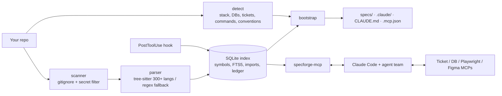

# SpecForge

**Turn any existing repo into spec-driven development with one command.** SpecForge indexes your code, learns your stack and conventions, and sets up everything Claude Code needs to work like a disciplined team: a token-saving code-index MCP, project-specific skills, an 8-agent team, lifecycle commands from ticket grooming to Playwright E2E, and connectors for your ticket system and databases.

```bash
cd your-repo
specforge init        # ~1 second on a 250-file repo; no AI calls, nothing leaves your machine
claude                # then: /sf:learn, /sf:flow PROJ-123
```

On [full-stack-fastapi-template](https://github.com/fastapi/full-stack-fastapi-template) (React + FastAPI + Postgres), 13 typical lookups returned **18% of the tokens** that reading the same files whole would have cost (**82% saved**, measured by the built-in ledger).

---

## What `specforge init` creates

```
your-repo/
├── CLAUDE.md                    # SpecForge block added (your content is kept)
├── .mcp.json                    # specforge + matching connectors (no secrets; ${ENV} refs)
├── .claude/
│   ├── commands/sf/             # 14 lifecycle commands (below)
│   ├── agents/                  # spec-analyst, architect, frontend/backend engineer,
│   │                            # db-optimizer, qa-engineer, e2e-tester, reviewer
│   ├── skills/                  # code-navigation, spec-writing, test-case-design,
│   │                            # playwright-e2e, db-optimization (only your engines),
│   │                            # <repo>-conventions, frontend-patterns, backend-patterns
│   └── settings.json            # hook: re-index files right after Claude edits them
├── specs/
│   ├── project.md               # stack, commands, sub-projects, modules
│   ├── conventions.md           # naming, layout, tests, lint + reference implementations
│   ├── modules/<module>.md      # reverse-engineered public API with code refs
│   └── features/_template/      # requirements, design, tasks, test-cases
└── .specforge/                  # local index (SQLite), config, spec lock, report.html
```

Everything is **detected, not configured**: languages (300+ via tree-sitter, regex fallback for anything else), frameworks, ORMs, databases (from dependencies, docker-compose, Prisma, connection strings, `.env.example`, Spring/ASP.NET config), test tools, CI, ticket system (from git remotes, CI files and `PROJ-123` / `AB#123` keys in commit history), and per-sub-project commands in monorepos. Override anything in `.specforge/config.json` or with flags.

## The workflow

| Command | Agent | What it does |
|---|---|---|
| `/sf:groom <ticket>` | spec-analyst | Pulls the ticket (Jira / Azure DevOps / GitHub / Linear / GitLab MCP), INVEST check, Gherkin ACs, estimate, split, risks, open questions with defaults |
| `/sf:design <id>` | architect | Options + decision (mini ADR), Mermaid diagram, API contract, data model + migration, component tree, `data-testid` plan, security, test strategy. Uses Figma MCP if linked |
| `/sf:plan <id>` | architect | ≤ half-day tasks, each with a pass/fail check, mapped to ACs, parallel tasks marked |
| `/sf:be <id>` / `/sf:fe <id>` | backend / frontend engineer | Implements by mirroring the closest existing code in the repo, tests included |
| `/sf:db <id\|query\|audit>` | db-optimizer | N+1 hunt, **real** read-only plans via the DB MCP (Postgres, MySQL, SQL Server, MongoDB, SQLite), index migrations with rollback |
| `/sf:qa <id>` | qa-engineer | Manual test cases using EP, BVA, decision tables, state transitions; traceability matrix; CSV for TestRail / Xray / Azure Test Plans |
| `/sf:e2e <id>` | e2e-tester | Explores the running app with **Playwright MCP**, then writes role-based Playwright tests per AC and checks them for flakiness |
| `/sf:verify <id>` | reviewer | AC → code → test table, spec drift, diff review, quality gates; PASS or numbered fixes |
| `/sf:ship <id>` | — | PR description, changelog, release note, ticket update (asks first) |
| `/sf:flow <ticket>` | orchestrator | **Runs the whole team**: groom → design → plan → parallel FE/BE + QA → E2E → verify, with human gates (or `--auto`) |
| `/sf:spec`, `/sf:status`, `/sf:learn` | — | Quick spec for small changes; board of all features; AI enrichment of the generated specs and skills |

## The code-index MCP (token reduction)

Agents burn most of their tokens reading whole files to find one function. `specforge-mcp` gives them surgical tools instead:

| Tool | Returns |
|---|---|
| `repo_map` | modules and key symbols with `file:line` |
| `get_context(task, budget)` | ranked, budgeted code for a task: full bodies for the best matches, signatures for the rest (stemming, synonyms like *endpoint → route/controller*, generated code and tests down-ranked) |
| `search_symbols`, `file_outline`, `get_symbol` | symbol search, signatures only, one exact symbol |
| `find_references`, `impact_of`, `changed_symbols` | usages with enclosing symbol, reverse dependencies, symbols touched by a diff |
| `read_spec(path, section)`, `list_specs`, `spec_drift` | section-level spec reads and drift checks |
| `project_profile`, `reindex`, `token_savings` | detected stack, refresh, the savings ledger |

Every call is logged against a *whole-file baseline* so the savings are measured, not claimed. `specforge stats` and `.specforge/report.html` show them.

## Specs that can't silently rot

Specs reference code as `` `path::Qualname` ``. `specforge drift` checks each reference against the index: **missing** (renamed or deleted), **changed** (code changed since the spec was verified), or **unverified**. `specforge drift --lock` records the reviewed state; `specforge init --ci` adds a GitHub Action that fails PRs which break specs.

## Privacy and security

- **Local only.** Indexing, detection, drift and reports run on your machine. No telemetry and no network calls (tree-sitter grammars are downloaded once, on first use, from the package's own source).
- **Your code only goes where it already goes**: to the model your Claude Code account uses, and only the snippets the agent asks for.
- **Secrets are never indexed** (`.env*`, keys, keystores, credential files, tfstate…) and secret-looking values (private keys, cloud and API tokens, passwords, credentials in URLs) are **redacted** from tool output.
- **Connector configs hold no secrets**: `.mcp.json` uses `${ENV_VAR}` references. Database connectors default to read-only or restricted modes.
- **Generated specs are labelled as reverse-engineered**: they describe what the code does, which may include bugs. Review before you rely on them.

## Install

Requires Python 3.10+. Node 18+ (`npx`) and `uv` (`uvx`) are needed only for the connectors that use them.

```bash
uv tool install git+https://github.com/YOUR_GITHUB_USER/specforge   # or: pipx install ...
specforge doctor
```

`specforge-mcp` must be on your `PATH` so Claude Code can start it from `.mcp.json`.

## CLI

```
specforge init [path] [--dry-run] [--tickets jira] [--db postgres,mongodb] [--app-url URL] [--ci] [--force]
specforge connect                 # list the connector catalog
specforge connect jira figma      # add connectors to .mcp.json  (--remove to drop)
specforge index [--full] | detect | stats | drift [--lock] [--strict] | report | doctor | serve
```

Connectors: `playwright`, `github`, `jira`, `atlassian-remote`, `azure-devops`, `linear`, `gitlab`, `postgres`, `mysql`, `sqlserver`, `sqlite`, `mongodb`, `figma`, `sentry`, `context7`. The catalog lives in `src/specforge/assets/connectors/catalog.json`; check package names and URLs against each vendor's current docs before rolling out to a team.

## Architecture



## Development

```bash
pip install -e . && pytest -q
python tests/mcp_smoke.py /path/to/repo     # exercises every MCP tool over stdio
```

License: MIT.
