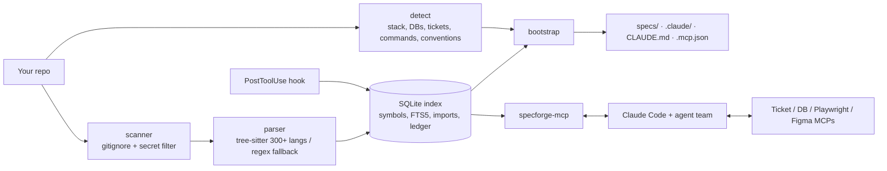

# SpecForge

[](https://github.com/Abdulwahab26/Specforge/actions/workflows/ci.yml)  

**Turn any existing repo into spec-driven development with one command.** SpecForge indexes your code locally, learns your stack and conventions, and sets up everything your AI coding tool needs (Claude Code, GitHub Copilot, Cursor, Augment Code, Windsurf, Codex, Kiro, Gemini CLI or Replit) to work like a disciplined team: a token-saving code-index MCP, project-specific skills, a 13-agent team, lifecycle commands from ticket grooming to Playwright E2E, a planner/executor unit-test pipeline on the models you choose, ticket-history backfill, complete repository documentation for any repo type (backend, frontend, QA automation, Azure Functions, Lambda, infra, library, CLI, data, mobile), and connectors for your ticket system and databases.

Design notes and decision records: [docs/ARCHITECTURE.md](docs/ARCHITECTURE.md) · measured numbers: [docs/BENCHMARKS.md](docs/BENCHMARKS.md) · head-to-head: [docs/COMPARISON.md](docs/COMPARISON.md)

```bash
cd your-repo
specforge init        # ~1 second on a 250-file repo; no AI calls, nothing leaves your machine
claude                # then: /sf:learn, /sf:flow PROJ-123
```

| Measured | Result |
|---|---|
| jCodeMunch's own benchmark (same repos, queries, workflow, tokenizer) | **66% fewer tokens** than jCodeMunch (5,924 vs 17,581) |
| Cold index incl. call/import graphs vs jCodeMunch (express / fastapi / gin) | **2–6× faster** (0.27–0.34 / 3.44–4.02 / 0.39–0.48 s vs 1.72 / 7.07 / 1.56 s) |
| Symbols indexed vs jCodeMunch (express / fastapi / gin) | 994 / **26,842** / **1,960** vs 1,085 / 13,699 / 1,822 |
| jCodeMunch's 98 tool names | **every one has an implemented equivalent** ([table](docs/COMPARISON.md#5-tools-every-jcodemunch-tool-mapped)), plus SpecForge-only tools |
| Tool schema per turn vs jCodeMunch | default **~790** vs ~1,050 tokens (6 tools each); everything **~7,870** vs ~28,142 |
| Starter packs | **51** curated (npm / PyPI / Go / GitHub), fetched from the registry, **no install needed** |
| Paraphrased tasks in `get_context` with local embeddings | **8/12** found (3/12 keyword-only) |
| Token savings, 13 typical lookups on [full-stack-fastapi-template](https://github.com/fastapi/full-stack-fastapi-template) | **84% fewer tokens** than reading the files |
| Retrieval eval (12 tasks, 4k budget) | recall **1.00**, MRR **0.88** (CI gate: ≥ 0.95 / ≥ 0.75) |
| Refresh after an edit on Django (5.6k files) | **0.14 s** (no-op: 0.09 s) |
| Network calls during indexing | **none** (tested with sockets blocked) |

---

## Works with your AI coding tool

`specforge init` detects which AI coding tools the repo already uses (from their config folders) and writes the same setup in each tool's own formats: always-on rules, the lifecycle workflows, role agents, skills and the MCP connection. Pick tools explicitly with `--agents cursor,copilot` or `--agents all`.

| Tool | Run a workflow | Files SpecForge writes |
|---|---|---|
| Claude Code | `/sf:groom` | `CLAUDE.md`, `.claude/commands`, `.claude/agents`, `.claude/skills`, `.mcp.json` |
| GitHub Copilot | `/sf-groom` | `AGENTS.md`, `.github/prompts`, `.github/agents`, `.github/skills`, `.vscode/mcp.json` |
| Cursor | `/sf-groom` | `AGENTS.md`, `.cursor/commands`, `.cursor/rules/*.mdc`, `.cursor/mcp.json` |
| Augment Code | `/sf:groom` | `AGENTS.md`, `.augment/commands`, `.augment/skills`, MCP import file |
| Windsurf / Devin Local | `sf-groom` skill | `AGENTS.md`, `.agents/skills`, `.devin/mcp_config.json` |
| OpenAI Codex | `sf-groom` skill | `AGENTS.md`, `.agents/skills`, `.codex/agents`, `.codex/config.toml` |
| Kiro | `#sf-groom` | `AGENTS.md`, `.kiro/steering`, feature specs in `.kiro/specs/`, `.kiro/settings/mcp.json` |
| Gemini CLI | `/sf:groom` | `GEMINI.md`, `.gemini/commands/*.toml`, `.gemini/settings.json` |
| Replit Agent | groom playbook | `replit.md`, `.specforge/playbooks`; tools via `specforge tool <name> '<json>'` (no local MCP) |

Details, per-tool limits and the documentation each format was checked against: [docs/PROVIDERS.md](docs/PROVIDERS.md).

## What `specforge init` creates

```
your-repo/
├── CLAUDE.md                    # SpecForge block added (your content is kept)
├── .mcp.json                    # specforge + matching connectors (no secrets; ${ENV} refs)
├── .claude/
│   ├── commands/sf/             # 21 commands (below)
│   ├── agents/                  # spec-analyst, architect, frontend/backend engineer, db-optimizer,
│   │                            # qa-engineer, e2e-tester, reviewer, unit-test-planner,
│   │                            # unit-test-executor, ticket-archaeologist, doc-writer, summarizer
│   ├── skills/                  # code-navigation, spec-writing, test-case-design,
│   │                            # playwright-e2e, db-optimization (only your engines),
│   │                            # <repo>-conventions, frontend-patterns, backend-patterns
│   └── settings.json            # hooks: secret guard (PreToolUse), re-index (PostToolUse), dedupe reset (PreCompact)
├── specs/
│   ├── project.md               # stack, commands, sub-projects, modules
│   ├── conventions.md           # naming, layout, tests, lint + reference implementations
│   ├── modules/<module>.md      # reverse-engineered public API with code refs
│   └── features/_template/      # requirements, design, tasks, test-cases
└── .specforge/                  # local index (SQLite), config, spec lock, report.html
```

Everything is **detected, not configured**: languages (300+ via tree-sitter, regex fallback for anything else), frameworks, ORMs, databases (from dependencies, docker-compose, Prisma, connection strings, `.env.example`, Spring/ASP.NET config), test tools, CI, ticket system (from git remotes, CI files and `PROJ-123` / `AB#123` keys in commit history), and per-sub-project commands in monorepos. Override anything in `.specforge/config.json` or with flags.

## The workflow

| Command | Agent | What it does |
|---|---|---|
| `/sf:groom <ticket>` | spec-analyst | Pulls the ticket (Jira / Azure DevOps / GitHub / Linear / GitLab MCP), INVEST check, Gherkin ACs, estimate, split, risks, open questions with defaults |
| `/sf:design <id>` | architect | Options + decision (mini ADR), Mermaid diagram, API contract, data model + migration, component tree, `data-testid` plan, security, test strategy. Uses Figma MCP if linked |
| `/sf:plan <id>` | architect | ≤ half-day tasks, each with a pass/fail check, mapped to ACs, parallel tasks marked |
| `/sf:be <id>` / `/sf:fe <id>` | backend / frontend engineer | Implements by mirroring the closest existing code in the repo, tests included |
| `/sf:db <id\|query\|audit>` | db-optimizer | N+1 hunt, **real** read-only plans via the DB MCP (Postgres, MySQL, SQL Server, MongoDB, SQLite), index migrations with rollback |
| `/sf:qa <id>` | qa-engineer | Manual test cases using EP, BVA, decision tables, state transitions; traceability matrix; CSV for TestRail / Xray / Azure Test Plans |
| `/sf:e2e <id>` | e2e-tester | Explores the running app with **Playwright MCP**, then writes role-based Playwright tests per AC and checks them for flakiness |
| `/sf:verify <id>` | reviewer | AC → code → test table, spec drift, diff review, quality gates; PASS or numbered fixes |
| `/sf:ship <id>` | — | PR description, changelog, release note, ticket update (asks first) |
| `/sf:flow <ticket>` | orchestrator | **Runs the whole team**: groom → design → plan → parallel FE/BE + QA → E2E → verify, with human gates (or `--auto`) |
| `/sf:test-plan <module>` | unit-test-planner (**your planner model**) | Deep test analysis from `test_surface` (branches, side effects, existing tests, real coverage), then executable milestones with technical challenges and approaches, schema-validated |
| `/sf:test-run <module>` | unit-test-executor (**your executor model**) | Implements milestones one by one; "done" is accepted only when the tool re-runs the tests and they pass; ambiguity is escalated as `blocked`, never improvised |
| `/sf:backfill` | ticket-archaeologist | Opt-in: pulls Done / In Progress / In Review tickets through your ticket MCP and writes linked specs, resumable, in parallel batches |
| `/sf:docs [missing\|stale\|all\|ids]` | doc-writer (**your docs model**) | Detects the repo type(s) and writes every required document (up to 25 for an Azure Functions repo) from locally extracted facts: endpoints, functions + triggers, settings, routes, test inventory, models, infra. `specforge docs check` enforces sections, full coverage (every endpoint/function/setting mentioned), no placeholders, valid links; docs go **stale** automatically when the code they describe changes |
| `/sf:analyze` | — | Architecture health: PageRank importance, hotspots, cycles, coupling, layer violations, dead code, risky AST patterns, with refactor plans |
| `/sf:summarize` | summarizer (**your summarizer model**) | One-line summaries for undocumented code, written into the index (cached by code hash) to sharpen search and outlines |
| `/sf:profile` | — | Show or change your models per role and backfill settings |
| `/sf:spec`, `/sf:status`, `/sf:learn` | — | Quick spec for small changes; board of all features; AI enrichment of the generated specs and skills |

## The code-index MCP (token reduction)

Agents burn most of their tokens reading whole files to find one function. `specforge-mcp` gives them surgical tools instead:

| Tool | Returns |
|---|---|
| `repo_map` | modules and key symbols with `file:line` |
| `search_symbols(mode=)` | lexical, hybrid (body vocabulary + embeddings, RRF) or semantic; `auto` falls back to hybrid on weak matches |
| `get_symbol(s)` | exact source; **already-sent bodies return a one-line reference** (session dedupe, reset on compaction); large symbols return a skeleton; `focus=` excerpts |
| `get_context(task, budget)` | ranked, budgeted code for a task: full bodies for the best matches, signatures for the rest (stemming, synonyms like *endpoint → route/controller*, generated code and tests down-ranked) |
| `search_symbols`, `file_outline`, `get_symbol` | symbol search, signatures only, one exact symbol |
| `find_references`, `impact_of`, `changed_symbols`, `hotspots` | usages with enclosing symbol, transitive dependents, symbols touched by a diff, complexity × churn |
| `call_hierarchy`, `class_hierarchy`, `symbol_importance`, `dead_code` | resolved call graph both ways, inheritance up/down, PageRank, verified unused code |
| `dependency_cycles`, `coupling`, `layer_violations`, `pr_risk` | import cycles, Ca/Ce/instability, wrong-way dependencies, 0–1 change risk with review tips |
| `search_ast`, `plan_refactor` | tree-sitter structural queries + 10 anti-pattern presets; reviewable rename/signature/move edit plans |
| `summaries_needed`, `save_summaries`, `list_sources`, `add_source` | AI summaries via your Claude; dependency packs and external repos (`source=` on the core tools) |
| `read_spec(path, section)`, `list_specs`, `spec_drift` | section-level spec reads and drift checks |
| `test_surface`, `validate_test_plan`, `next_test_milestone`, `update_test_milestone` | unit-test analysis and the enforced milestone workflow |
| `doc_plan`, `doc_facts`, `doc_check`, `doc_register` | documentation plan by archetype, grounded facts, completeness gate, freshness lock |
| `ticket_keys`, `ticket_trace`, `backfill_progress` | ticket keys in git history, ticket → commits → symbols, resumable backfill state |
| `project_profile`, `get_profile`, `reindex`, `token_savings` | detected stack, your model/backfill profile, refresh, the savings ledger |
| `symbol_complexity`, `file_risk`, `untested_symbols`, `winnow_symbols` | cyclomatic / nesting / params per symbol or folder, per-symbol risk, code with no test evidence, multi-filter symbol queries |
| `similar_symbols`, `related_symbols`, `extraction_candidates` | near-duplicate code, symbols that change and are used together, what to extract and why |
| `entry_points`, `signal_chains`, `flow_edges`, `endpoint_impact` | where execution starts, entry → leaf call chains, route→handler / event emit→listener / DI links, what an endpoint touches incl. frontend callers |
| `tectonic_map`, `architecture_metrics`, `repo_health`, `decorator_census` | module plates and fault lines, size/depth/fan metrics, six-axis health radar with trend vs last run, decorator usage |
| `dependency_graph`, `find_implementations`, `check_safety`, `parity_map`, `search_columns` | file or folder imports/importers, implementers (incl. Go implicit interfaces), edit/delete/rename preflight, sibling-module parity, DB columns/fields |
| `symbol_provenance`, `symbol_diff`, `churn_rate`, `digest`, `delivery_metrics` | git story of a symbol (tickets, decisions), symbols added/changed between refs, churn, what changed since X, delivery stats |
| `render_diagram`, `audit_agent_config`, `runtime_coverage` | Mermaid call/class/deps/modules/sequence/tectonic, wasted tokens in CLAUDE.md/skills/MCP config, hot and never-executed code from lcov/Cobertura/JaCoCo |
| `plan_turn`, `suggest_queries`, `session_snapshot`, `tool_stats`, `redaction_log`, `index_status` | budgeted first-turn plan, starter queries, what's already in context (survives compaction), per-tool latency, what was redacted, freshness + embedding-model drift |
| `file_tree`, `get_file_content`, `list_workspaces`, `cross_repo_map`, `list_packs`, `add_pack` | navigation, line-range reads, other indexed repos and their links, starter packs |
| `import_runtime_trace`, `runtime_hot_paths`, `runtime_unused` | OpenTelemetry traces (OTLP JSON / JSONL / gzip) mapped to symbols by code attributes, HTTP route or name: hits and p50 / p95 latency per symbol, code never executed in real traffic; latency also feeds `file_risk` |
| `suggest_corrections`, `tune_weights` | why searches miss (mined from the local query → fetch ledger) with synonym rules you can apply; fusion-weight tuning on an eval file or the ledger |
| `group_contracts`, `finalize_handoff` | APIs shared across repos with their consumers (the breaking-change surface); one validated Markdown handoff whose code references are checked against the index |
| `set_tool_tier`, `run_tool` | switch tool sets mid-session (sends `tools/list_changed`; a model id picks a tier), or call any tool by name |

Besides code, the index holds **config keys** (`jobs.build.runs-on`, `scripts.test`, `services.db.image`; `.env` values are never stored) and **documentation sections** (Markdown / RST / AsciiDoc headings, fetchable one section at a time). Both rank below code unless the query asks for docs.

Every call is logged against a *whole-file baseline* so the savings are measured, not claimed. `specforge stats` and `.specforge/report.html` show them.

### Starter packs (no install)

```bash
specforge pack list                  # 51 curated: react, next, vue, angular, express, nestjs, fastapi, django, flask, gin, spring-framework, azure-functions-*, …
specforge pack add react             # fetches the published source from the registry, indexes it locally
specforge pack add pypi:httpx@0.27.0 # or any npm:/pypi:/go:/gh: package at any version
specforge pack export npm:react -o react.sfpack   # share a pack offline; `specforge pack import` on the other side
```
Archives are extracted with path-traversal, absolute-path and size checks; packs are registered as sources, so every core tool accepts `source="npm:react"`.

Tool tiers keep the per-turn schema small. The default `lite` tier is 6 tools (~790 tokens: `repo_map`, `search_symbols`, `get_symbol`, `get_context`, `set_tool_tier`, `run_tool`); then `core` (11, ~1.2k), `standard` (32, ~3.0k), `analysis` (62, ~5.4k), `full` (92, ~7.9k; jCodeMunch's full surface is ~28k). Agents switch with `set_tool_tier` when a task needs more, or call a single tool with `run_tool`. Pin a tier with `"tool_tier"` in `.specforge/config.json` or `SPECFORGE_TOOLS`. Set with `"tool_tier"` in `.specforge/config.json` or `SPECFORGE_TOOLS`.

## Your profile: models per role

Model choices are personal, so they live in `~/.specforge/profile.json` (never committed) and are applied to the agents' `model:` frontmatter:

```bash
specforge profile                                   # show
specforge profile set models.test_planner opus      # deep analysis
specforge profile set models.test_executor haiku    # cheap execution
specforge profile set models.reviewer sonnet        # any role: spec_analyst, architect, frontend, backend, db, qa, e2e, reviewer, backfill
specforge profile set backfill.enabled true
specforge profile set backfill.statuses "Done,In Review,In Progress"
```
Values are validated (`opus`, `sonnet`, `haiku`, `fable`, `inherit`, or a full model ID). Precedence: built-in defaults < team defaults in `.specforge/config.json` (`profile_defaults`) < your profile.

## Specs that can't silently rot

Specs reference code as `` `path::Qualname` ``. `specforge drift` checks each reference against the index: **missing** (renamed or deleted), **changed** (code changed since the spec was verified), or **unverified**. `specforge drift --lock` records the reviewed state; `specforge init --ci` adds a GitHub Action that fails PRs which break specs.

## Privacy and security

- **Local only.** Indexing, detection, drift, test analysis and reports run on your machine with no telemetry. Indexing never touches the network (a test blocks sockets to prove it). The one network step is fetching tree-sitter grammars, done explicitly by `specforge grammars` or by `init` (skip with `--offline`; uncached languages then use the built-in regex extractor).
- **Enforced, not just instructed.** A `PreToolUse` hook blocks Claude from reading or writing secret files; unit-test "done" is verified by running the tests; plans are schema-checked. See the enforcement table in [docs/ARCHITECTURE.md](docs/ARCHITECTURE.md).
- **Your code only goes where it already goes**: to the model your Claude Code account uses, and only the snippets the agent asks for.
- **Secrets are never indexed** (`.env*`, keys, keystores, credential files, tfstate…) and secret-looking values (private keys, cloud and API tokens, passwords, credentials in URLs) are **redacted** from tool output.
- **Connector configs hold no secrets**: `.mcp.json` uses `${ENV_VAR}` references. Database connectors default to read-only or restricted modes.
- **Generated specs are labelled as reverse-engineered**: they describe what the code does, which may include bugs. Review before you rely on them.

## Install

Requires Python 3.10+. Node 18+ (`npx`) and `uv` (`uvx`) are needed only for the connectors that use them.

```bash
uv tool install git+https://github.com/Abdulwahab26/Specforge   # or: pipx install git+https://github.com/Abdulwahab26/Specforge
specforge doctor
```

`specforge-mcp` must be on your `PATH` so Claude Code can start it from `.mcp.json`.

## CLI

```
specforge init [path] [--agents auto|all|cursor,copilot,...] [--dry-run] [--offline] [--tickets jira] [--db postgres,mongodb] [--app-url URL] [--ci] [--force]
specforge agents list | add <tools> | all     # AI coding tools to set up
specforge tool <name> '<json args>' | --list  # any MCP tool from the shell (for tools without local MCP)
specforge profile [set|unset|sync] ...   # your models per role and backfill settings
specforge tests surface|validate|status <module>
specforge grammars [--list]              # explicit, one-time grammar download
specforge docs plan|status|check [--strict]|facts <id>
specforge analyze importance|dead|cycles|coupling|layers|risk|hotspots|ast [--preset X]
specforge embed [--code-model]          # optional local embeddings (pip install 'specforge[semantic]')
specforge source add|list|remove pkg:react | gh:owner/repo[@ref] | path:../svc
specforge watch [--embed]
specforge pack list | add <name|npm:x|pypi:x|go:x|gh:o/r>[@ver] | export <source> -o x.sfpack | import x.sfpack
specforge insight health|untested|similar|complexity|extract|entry|chains|tectonic|architecture|decorators|flow|
                  columns|safety|endpoint|risk-file|provenance|diff|digest|delivery|churn|audit [target]
specforge insight trace-import <otel.json[.gz]> | hot | unused | corrections [--apply] | tune [eval.json] [--apply] | contracts
specforge diagram call|class|deps|modules|sequence|tectonic [target] [-o diagram.html|.md]
specforge connect                 # list the connector catalog
specforge connect jira figma      # add connectors to .mcp.json  (--remove to drop)
specforge index [--full] | detect | stats | drift [--lock] [--strict] | report | doctor | serve
```

Connectors: `playwright`, `github`, `jira`, `atlassian-remote`, `azure-devops`, `linear`, `gitlab`, `postgres`, `mysql`, `sqlserver`, `sqlite`, `mongodb`, `figma`, `sentry`, `context7`. The catalog lives in `src/specforge/assets/connectors/catalog.json`; check package names and URLs against each vendor's current docs before rolling out to a team.

## Architecture



## Development

```bash
pip install -e . && pytest -q
python tests/mcp_smoke.py /path/to/repo     # exercises the core MCP tools over stdio
python tests/mcp_new_tools.py /path/to/repo # test, backfill and profile tools
python tests/mcp_v05_tools.py /path/to/repo # every analysis/history/session tool, fails on any tool error
python tests/mcp_v06_tools.py /path/to/repo # lite default, live tier switching, OTel, regret, contracts, handoff
python tests/evals/run_context_eval.py <repo> tests/evals/context_fullstack_fastapi.json
```

License: MIT.
