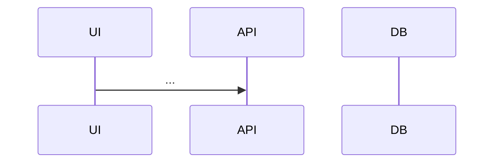

# <ID>: Design

## Context & goals
Goals mapped to ACs.

## Options considered
| Option | Pros | Cons |
|--------|------|------|
**Decision:** ... because ...

## Architecture


## API contract
```yaml
# OpenAPI-style
```

## Data model & migration
Changes, indexes, forward + rollback, backfill.

## Frontend
Component tree, state, loading/empty/error states, a11y, data-testid plan.

## Backend
Layers, validation, transactions, jobs.

## Security & privacy

## Observability

## Test strategy
| AC | Unit | Integration | E2E |
|----|------|-------------|-----|

## Code map
- `path::Symbol` (new|changed)
